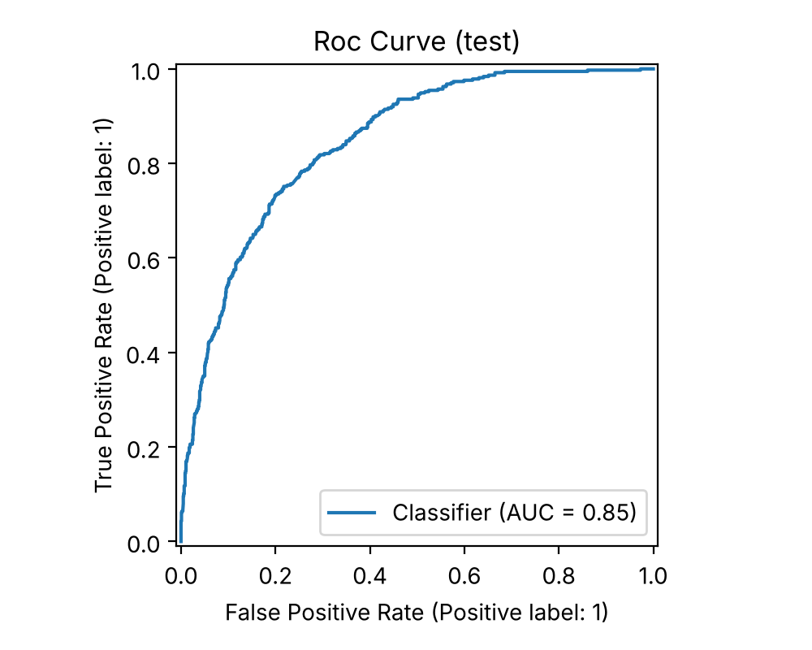

<p align="center">
  <picture>
    <source media="(prefers-color-scheme: dark)" srcset="docs/brand/logo-dark.png">
    
  </picture>
</p>

# ChurnGuard: end-to-end customer churn prediction with MLflow


Predicts which telecom customers are likely to cancel their subscription, so a retention team can act first. The focus is the **full ML lifecycle**, not just a notebook: reproducible runs, experiment tracking, hyperparameter tuning, a model registry with a promotion gate, a REST API, Docker, tests and CI.

**Dataset:** [IBM Telco Customer Churn](https://github.com/IBM/telco-customer-churn-on-icp4d). It has 7,043 customers, 19 features, and a churn rate of 26.5%.

## Results

| Model | CV ROC AUC | Test ROC AUC | Test F1 | Test recall |
|---|---|---|---|---|
| Logistic regression (baseline) | 0.846 | 0.842 | 0.618 | 0.743 |
| Random forest (baseline) | 0.827 | 0.818 | 0.526 | 0.460 |
| HistGradientBoosting (baseline) | 0.835 | 0.835 | 0.615 | 0.687 |
| **HistGradientBoosting, Optuna-tuned (champion)** | **0.849** | **0.846** | **0.636** | **0.743** |

The champion catches about **3 out of 4 churners** (recall 0.74). The decision threshold is tuned for F1 (0.58), not left at 0.5. The models are ranked by **cross-validated** score, so the test set is only used for the final report, never for choosing a model.

| ROC curve | Top churn drivers |
|---|---|
|  |  |

**What drives churn:** short tenure and month-to-month contracts dominate, followed by fiber-optic internet without online security or tech support. These are actionable: offer longer contracts and bundle support for new fiber customers.

## Architecture

```
            ┌──────────────┐   ┌────────────────────┐   ┌──────────────────┐   ┌──────────────────┐
 IBM CSV ──►│ prepare_data │──►│ train (3 baselines)│──►│ tune (Optuna,    │──►│ register         │
            │ validate,    │   │ 5-fold CV, plots,  │   │ nested runs)     │   │ promotion gate → │
            │ clean, split │   │ signature, model   │   │ refit best model │   │ @champion alias  │
            └──────────────┘   └────────────────────┘   └──────────────────┘   └────────┬─────────┘
                    │                    │                      │                       │
                    └────────────── MLflow Tracking (params, metrics, plots, datasets) ─┤
                                                                                        ▼
                                          FastAPI  ◄── loads models:/churn-classifier@champion
                                    /predict  /predict/batch  /model-info  /health  /reload
```

## Key engineering decisions

- **A single sklearn `Pipeline`** (feature engineering → scaling/one-hot → model) is logged as the model, so the exact same transformations run at training time and at serving time. This rules out training/serving skew.
- **MLflow Projects** (`MLproject`) give every step a reproducible entry point with typed parameters: `mlflow run . -e tune -P n_trials=50`.
- **Nested runs:** one `mlflow run` shows up as a single tree in the UI: data prep → baselines → tuning parent → 30 trial children → refit best model.
- **Model registry with aliases** (`@champion`), the MLflow 3 replacement for deprecated stages. A new model is promoted only if it beats the current champion's CV score, and re-running is a no-op.
- **Models are logged with a signature, an input example, and the source code** (`code_paths`), so they load in any environment.
- **Input validation at the edge:** Pydantic rejects bad requests (negative tenure, unknown contract type) with a 422 before they reach the model.
- **Hot reload:** `POST /reload` picks up a newly promoted champion without restarting the API.

## Quickstart

```bash
git clone https://github.com/YOUR_USERNAME/churn-mlops.git && cd churn-mlops
python -m venv .venv && source .venv/bin/activate      # Windows: .venv\Scripts\activate
make install

make pipeline          # download data → train baselines → tune → register champion (~2–3 min)
make ui                # MLflow UI     → http://localhost:5000
make serve             # API + Swagger → http://localhost:8000/docs
make test              # 21 unit + API tests
```

No `make` (for example, on Windows)? Run the commands directly:

```bash
set PYTHONPATH=src;.          # macOS/Linux: export PYTHONPATH=src:.
set MLFLOW_TRACKING_URI=sqlite:///mlflow.db
python -m churn.pipeline --n-trials 30
mlflow ui --backend-store-uri sqlite:///mlflow.db
uvicorn api.app:app --port 8000
```

### Run it as an MLflow Project

```bash
export MLFLOW_TRACKING_URI=sqlite:///$PWD/mlflow.db
mlflow run . --env-manager local --experiment-name churn-prediction              # full pipeline
mlflow run . --env-manager local --experiment-name churn-prediction -e train -P model_type=random_forest
mlflow run . --env-manager local --experiment-name churn-prediction -e tune  -P n_trials=50
mlflow run . --env-manager local --experiment-name churn-prediction -e register
```

Drop `--env-manager local` to have MLflow build an isolated virtualenv from `python_env.yaml`.

### Docker (whole stack)

```bash
docker compose up --build
```

This starts an MLflow tracking server (http://localhost:5000), runs the training pipeline against it, then starts the API (http://localhost:8000/docs).

### Try the API

```bash
curl -X POST localhost:8000/predict -H "Content-Type: application/json" -d '{
  "gender": "Female", "SeniorCitizen": 0, "Partner": "Yes", "Dependents": "No",
  "tenure": 2, "PhoneService": "Yes", "MultipleLines": "No", "InternetService": "Fiber optic",
  "OnlineSecurity": "No", "OnlineBackup": "No", "DeviceProtection": "No", "TechSupport": "No",
  "StreamingTV": "Yes", "StreamingMovies": "Yes", "Contract": "Month-to-month",
  "PaperlessBilling": "Yes", "PaymentMethod": "Electronic check",
  "MonthlyCharges": 95.5, "TotalCharges": 190.1 }'
# → {"churn_probability": 0.8986, "will_churn": true, "risk_level": "high"}
```

## Project structure

```
├── MLproject              # MLflow Project entry points
├── python_env.yaml        # environment for `mlflow run`
├── src/churn/
│   ├── config.py          # paths, columns, MLflow names
│   ├── data.py            # download, validate, clean, stratified split
│   ├── features.py        # FeatureEngineer + sklearn pipelines
│   ├── evaluate.py        # metrics, threshold tuning, plots, permutation importance
│   ├── train.py           # train + log one model
│   ├── tune.py            # Optuna search with nested runs
│   ├── register.py        # registry + champion promotion gate
│   ├── tracking.py        # works both standalone and under `mlflow run`
│   └── pipeline.py        # end-to-end orchestration
├── api/app.py             # FastAPI serving the @champion model
├── frontend/STITCH_PROMPTS.md   # prompts for designing the web UI in Google Stitch
├── docs/brand/            # logo (light/dark), app icon, favicon
├── tests/                 # pytest: data, features, API (synthetic data, no network)
├── Dockerfile, docker-compose.yml
└── .github/workflows/ci.yml     # lint → tests → real training smoke run → docker build
```

## Ideas for extending it

- A web frontend: designs are ready in `frontend/STITCH_PROMPTS.md`
- Data drift monitoring with Evidently on incoming prediction requests
- Per-prediction explanations with SHAP, returned from `/predict`
- Remote artifact storage (S3 or MinIO) and a Postgres backend for the tracking server
- Scheduled retraining (GitHub Actions cron or Airflow) that only promotes models that pass the gate
