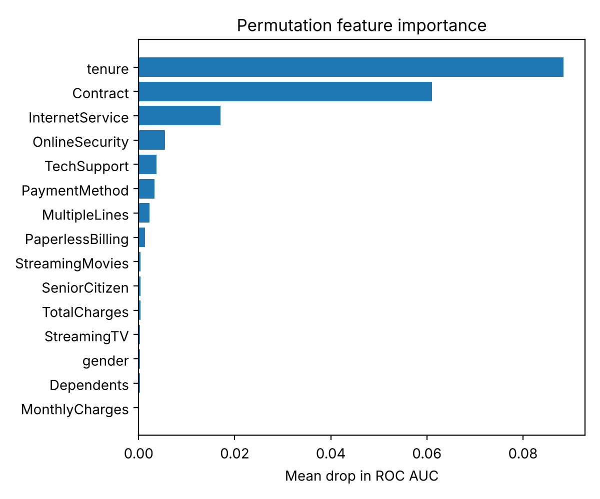

<p align="center">
  <picture>
    <source media="(prefers-color-scheme: dark)" srcset="docs/brand/logo-dark.png">
    
  </picture>
</p>

# ChurnGuard

[](https://github.com/YOUR_USERNAME/churnguard-mlops/actions/workflows/ci.yml)


[](LICENSE)

ChurnGuard predicts which telecom customers are about to cancel their subscription, and takes the model from raw data to a production API with MLflow managing every step in between.

## Features

- **Reproducible pipeline:** every step is an MLflow Project entry point with typed parameters
- **Experiment tracking:** parameters, metrics, plots, datasets and models are logged for every run, grouped as nested runs
- **Hyperparameter tuning:** Optuna TPE search, with every trial logged as its own MLflow run
- **Model registry with a promotion gate:** a new model only becomes `@champion` if it beats the current one on cross-validated ROC AUC
- **No training/serving skew:** feature engineering, preprocessing and the model are logged as a single scikit-learn `Pipeline`
- **Two ways to serve:** a FastAPI service with input validation and hot reload, or `mlflow models serve`
- **Production basics:** Docker Compose stack, 21 tests, linting, and GitHub Actions CI that runs a real training job

## Installation

**Requirements:** Python 3.10–3.12, and Git. Docker is optional.

(Recommended) Create and activate a virtual environment:

```bash
python -m venv .venv
source .venv/bin/activate        # Windows: .venv\Scripts\activate
 # or
conda create --name churnguard python=3.11
conda activate churnguard
```

### Minimal installation

Use this to train models and run the API:

```bash
git clone https://github.com/YOUR_USERNAME/churnguard-mlops.git
cd churnguard-mlops
pip install -r requirements.txt
```

### Development installation

This adds `pytest`, `httpx` and `ruff`:

```bash
pip install -r requirements-dev.txt
# verify the installation by running the tests
pytest -q
# 21 passed
```

### Docker installation

This starts the whole stack: an MLflow tracking server, a training job and the API.

```bash
docker compose up --build
```

| Service | URL | What it does |
|---|---|---|
| `mlflow` | http://localhost:5000 | Tracking server and model registry (SQLite + local artifact store) |
| `trainer` | — | Runs the full pipeline once, then exits |
| `api` | http://localhost:8000/docs | Serves `@champion`; starts after training finishes |

Set `N_TRIALS=50 docker compose up` to change the number of tuning trials.

### Environment setup

Every command below assumes these two variables are set, so the code is importable and runs are stored in a local SQLite database:

```bash
export PYTHONPATH=src:.
export MLFLOW_TRACKING_URI=sqlite:///mlflow.db
 # Windows (PowerShell)
$env:PYTHONPATH="src;."
$env:MLFLOW_TRACKING_URI="sqlite:///mlflow.db"
```

On macOS/Linux, the `Makefile` sets them for you (`make pipeline`, `make serve`, `make test`, …).

## Usage

### Run the full pipeline

ChurnGuard is an [MLflow Project](https://mlflow.org/docs/latest/projects.html), so the whole pipeline is one command:

```bash
mlflow run . --env-manager local --experiment-name churn-prediction -P n_trials=30
```

or, without the MLflow Projects CLI:

```bash
python -m churn.pipeline --n-trials 30
```

Output:

```
Saved 5634 train / 1409 test rows to data/processed
[logreg] cv_auc=0.8456 test_auc=0.8416 f1=0.6178
[random_forest] cv_auc=0.8265 test_auc=0.8184 f1=0.5260
[hist_gb] cv_auc=0.8354 test_auc=0.8348 f1=0.6148
Best CV ROC AUC 0.8494 with {'learning_rate': 0.0158, 'max_depth': 2, 'max_iter': 500, ...}
[hist_gb] cv_auc=0.8494 test_auc=0.8456 f1=0.6362
Registered churn-classifier v1 as 'champion'
```

Open the MLflow UI to explore the runs:

```bash
mlflow ui --backend-store-uri sqlite:///mlflow.db --port 5000
```

Each entry point can also be run on its own:

```bash
mlflow run . -e prepare_data -P test_size=0.2
mlflow run . -e train        -P model_type=random_forest -P params='{"max_depth": 8}'
mlflow run . -e tune         -P model_type=hist_gb -P n_trials=50
mlflow run . -e register     -P min_improvement=0.002
```

(Add `--env-manager local --experiment-name churn-prediction` to each, or drop `--env-manager local` to let MLflow build an isolated environment from `python_env.yaml`.)

### Train a single model

From the command line:

```bash
python -m churn.train --model-type logreg --params '{"C": 0.5}'
# [logreg] cv_auc=0.8455 test_auc=0.8416 f1=0.6198 run_id=240365d5...
```

From Python, the same pipeline is a plain scikit-learn object:

```python
import pandas as pd
from churn.data import clean
from churn.features import build_pipeline, split_xy

df = clean(pd.read_csv("data/raw/telco_churn.csv"))
X, y = split_xy(df)

pipe = build_pipeline("logreg", {"C": 0.5}).fit(X, y)
print(pipe.predict_proba(X.head(2))[:, 1].round(3))
# [0.817 0.114]
```

### Promote a model to champion

```bash
python -m churn.register
# Best candidate run 9db8daea...: cv_roc_auc_mean=0.8494; current champion: none
# Registered churn-classifier v1 as 'champion'

python -m churn.register          # run again: nothing changes
# Best run is already the champion. Nothing to do.
```

The gate compares **cross-validated** ROC AUC, so the test set is only used for reporting and never for choosing a model. Use `--min-improvement 0.002` to require a margin.

### Load the champion model in Python

```python
import mlflow
import pandas as pd

model = mlflow.sklearn.load_model("models:/churn-classifier@champion")

customers = pd.read_parquet("data/processed/test.parquet").head(3)
customers["churn_probability"] = model.predict_proba(customers)[:, 1].round(3)
print(customers[["customerID", "Contract", "tenure", "churn_probability"]])
# customerID        Contract  tenure  churn_probability
# 4376-KFVRS        Two year      72              0.078
# 2754-SDJRD  Month-to-month       8              0.857
# 9917-KWRBE        One year      41              0.189
```

The model is logged with its source code (`code_paths`), a signature and an input example, so it loads in any environment that has the requirements installed.

### Serve with FastAPI

```bash
uvicorn api.app:app --port 8000
```

```bash
curl -X POST localhost:8000/predict -H "Content-Type: application/json" -d '{
  "gender": "Female", "SeniorCitizen": 0, "Partner": "Yes", "Dependents": "No",
  "tenure": 2, "PhoneService": "Yes", "MultipleLines": "No", "InternetService": "Fiber optic",
  "OnlineSecurity": "No", "OnlineBackup": "No", "DeviceProtection": "No", "TechSupport": "No",
  "StreamingTV": "Yes", "StreamingMovies": "Yes", "Contract": "Month-to-month",
  "PaperlessBilling": "Yes", "PaymentMethod": "Electronic check",
  "MonthlyCharges": 95.5, "TotalCharges": 190.1 }'
# {"churn_probability": 0.8986, "will_churn": true, "risk_level": "high"}
```

Interactive docs are at http://localhost:8000/docs. After promoting a new champion, call `POST /reload` to switch to it without restarting.

### Serve with MLflow

```bash
mlflow models serve -m "models:/churn-classifier@champion" -p 5001 --env-manager local
```

```bash
curl -X POST localhost:5001/invocations -H "Content-Type: application/json" \
  -d '{"dataframe_records": [{"gender": "Female", "SeniorCitizen": 0, "...": "..."}]}'
# {"predictions": [[0.9223, 0.0777]]}      # [P(stay), P(churn)]
```

## API Reference

| Method | Endpoint | Description |
|---|---|---|
| `GET` | `/health` | Service status and whether a model is loaded |
| `GET` | `/model-info` | Model name, version, type, decision threshold and metrics |
| `POST` | `/predict` | Score one customer → `churn_probability`, `will_churn`, `risk_level` |
| `POST` | `/predict/batch` | Score a list of customers |
| `POST` | `/reload` | Load the current `@champion` without restarting |

Invalid input (for example, negative `tenure` or an unknown `Contract` value) is rejected with **422** before it reaches the model. If no model is registered yet, prediction endpoints return **503**.

## Configuration

| Variable | Default | Description |
|---|---|---|
| `MLFLOW_TRACKING_URI` | `sqlite:///mlflow.db` (MLflow 3 default) | Where runs and the registry are stored, e.g. a SQLite file or `http://mlflow:5000` |
| `MLFLOW_EXPERIMENT_NAME` | `churn-prediction` | Experiment used when running scripts directly |
| `MLFLOW_MODEL_NAME` | `churn-classifier` | Registered model name |
| `MODEL_URI` | `models:/churn-classifier@champion` | Model the API serves; can point at any `runs:/` or `models:/` URI |
| `CORS_ORIGINS` | `http://localhost:3000,http://localhost:5173` | Frontend origins allowed to call the API |

## MLflow Project Entry Points

| Entry point | Parameters | Default | Description |
|---|---|---|---|
| `main` | `n_trials`, `test_size` | `30`, `0.2` | Full pipeline: data → baselines → tuning → registry |
| `prepare_data` | `test_size` | `0.2` | Download, validate, clean and split the data (stratified) |
| `train` | `model_type`, `params` | `hist_gb`, `{}` | Train and log one model with 5-fold CV |
| `tune` | `model_type`, `n_trials` | `hist_gb`, `30` | Optuna search, then refit and log the best model |
| `register` | `metric`, `min_improvement` | `cv_roc_auc_mean`, `0.0` | Register the best run and move `@champion` if it wins |

## Supported Models

| `model_type` | scikit-learn class | Class imbalance handling | Tuning search space |
|---|---|---|---|
| `logreg` | `LogisticRegression` | `class_weight="balanced"` | `C` |
| `random_forest` | `RandomForestClassifier` | `class_weight="balanced"` | `n_estimators`, `max_depth`, `min_samples_leaf`, `max_features` |
| `hist_gb` | `HistGradientBoostingClassifier` | `class_weight="balanced"` | `learning_rate`, `max_depth`, `max_iter`, `min_samples_leaf`, `l2_regularization` |

### Engineered Features

| Feature | Definition | Why it helps |
|---|---|---|
| `avg_monthly_spend` | `TotalCharges / max(tenure, 1)` | Separates price changes from tenure |
| `num_services` | Number of add-on services set to `"Yes"` | Customers with more services are more invested |
| `is_long_contract` | 1 if the contract is one or two years | The strongest single churn signal, made explicit |

## Results

**Dataset:** [IBM Telco Customer Churn](https://github.com/IBM/telco-customer-churn-on-icp4d). It has 7,043 customers, 19 features and a 26.5% churn rate, split 80/20 with stratification. Models are ranked by 5-fold cross-validated ROC AUC on the training set. The test set is held out for the final report only.

### Model Comparison

| Model | CV ROC AUC | Test ROC AUC | Test F1 | Test Recall |
|---|---|---|---|---|
| Logistic regression | 0.846 | 0.842 | 0.618 | 0.743 |
| Random forest | 0.827 | 0.818 | 0.526 | 0.460 |
| HistGradientBoosting | 0.835 | 0.835 | 0.615 | 0.687 |
| **HistGradientBoosting + Optuna (champion)** | **0.849 ± 0.012** | **0.846** | **0.636** | **0.743** |

### Champion Model on the Test Set

| ROC AUC | PR AUC | F1 | Precision | Recall | Accuracy | Decision threshold |
|---|---|---|---|---|---|---|
| 0.846 | 0.663 | 0.636 | 0.556 | 0.743 | 0.774 | 0.58 |

|  | Predicted: stay | Predicted: churn |
|---|---|---|
| **Actual: stay** | 813 | 222 |
| **Actual: churn** | 96 | **278** |

The model catches **278 of 374 churners (74%)**. The decision threshold is tuned for F1 on the training data instead of using the default 0.5. That trades some false alarms for fewer missed churners, which is usually the right call because a retention offer costs less than losing a customer.

| ROC curve | Top churn drivers (permutation importance) |
|---|---|
|  |  |

**Main finding:** short tenure and month-to-month contracts drive most churn, followed by fiber-optic internet without online security or tech support. A retention team can act on this directly, for example by offering annual-contract discounts or bundling tech support for new fiber customers.

## Testing

Tests use a small synthetic dataset, so they need no network access and run in a few seconds.

| Test file | Tests | Covers |
|---|---|---|
| `tests/test_data.py` | 5 | Schema validation, duplicate IDs, cleaning, stratified split |
| `tests/test_features.py` | 8 | Engineered features, zero tenure, all 3 model types, unseen categories |
| `tests/test_api.py` | 8 | Health, model info, single and batch prediction, 422 validation, 503 without a model |

```bash
pytest -q          # 21 passed
ruff check src api tests
```

CI (`.github/workflows/ci.yml`) runs lint and tests, then a **real training smoke run** that checks the champion model loads and predicts, and finally a Docker build.

## Project Structure

```
├── MLproject                  # MLflow Project entry points
├── python_env.yaml            # environment for `mlflow run`
├── src/churn/
│   ├── config.py              # paths, column names, MLflow names
│   ├── data.py                # download, validate, clean, split
│   ├── features.py            # FeatureEngineer + model pipelines
│   ├── evaluate.py            # metrics, threshold tuning, plots, permutation importance
│   ├── train.py               # train and log one model
│   ├── tune.py                # Optuna search with nested runs
│   ├── register.py            # model registry + champion promotion gate
│   ├── tracking.py            # works standalone and under `mlflow run`
│   └── pipeline.py            # end-to-end orchestration
├── api/app.py                 # FastAPI service
├── tests/                     # pytest suite
├── frontend/STITCH_PROMPTS.md # UI design prompts for Google Stitch
├── docs/                      # result plots and brand assets
├── Dockerfile, docker-compose.yml, Makefile
└── .github/workflows/ci.yml
```

## Roadmap

- [ ] Web dashboard (designs in `frontend/STITCH_PROMPTS.md`)
- [ ] Per-prediction explanations with SHAP, returned from `/predict`
- [ ] Data drift monitoring on incoming requests with Evidently
- [ ] Postgres backend and S3/MinIO artifact store for the tracking server
- [ ] Scheduled retraining that only promotes models that pass the gate

## License

This project is released under the [MIT License](LICENSE). The dataset is provided by IBM under its own terms.
