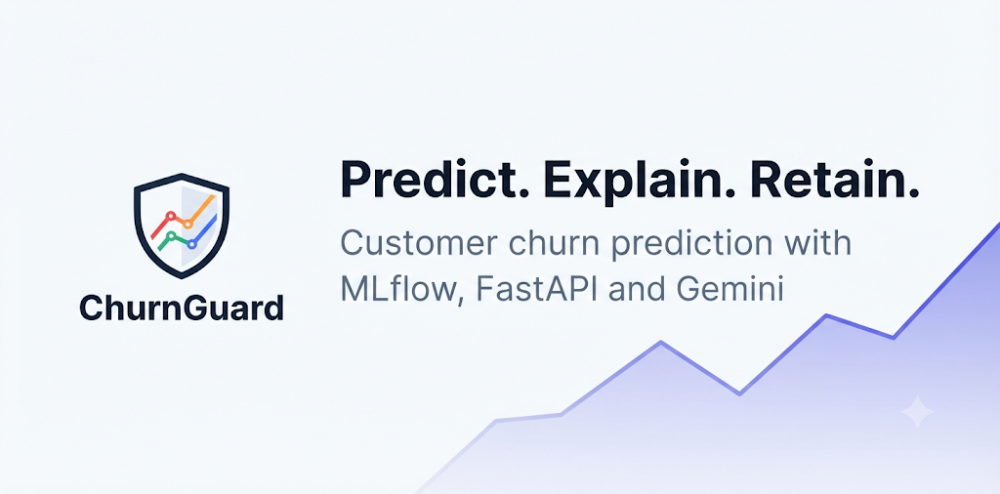
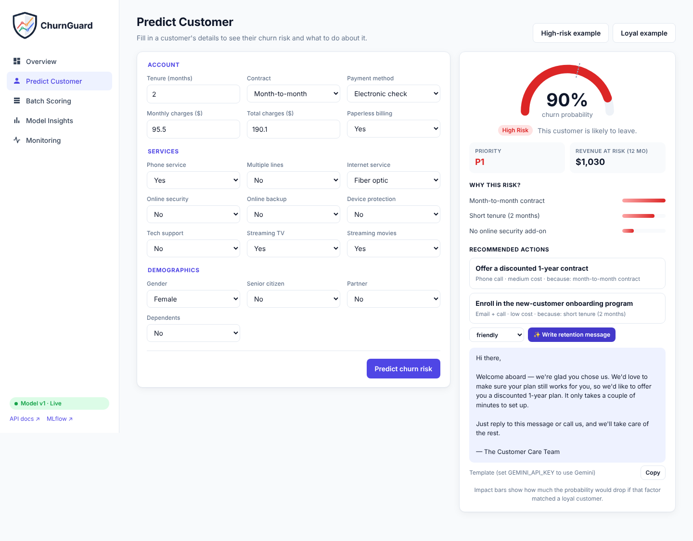
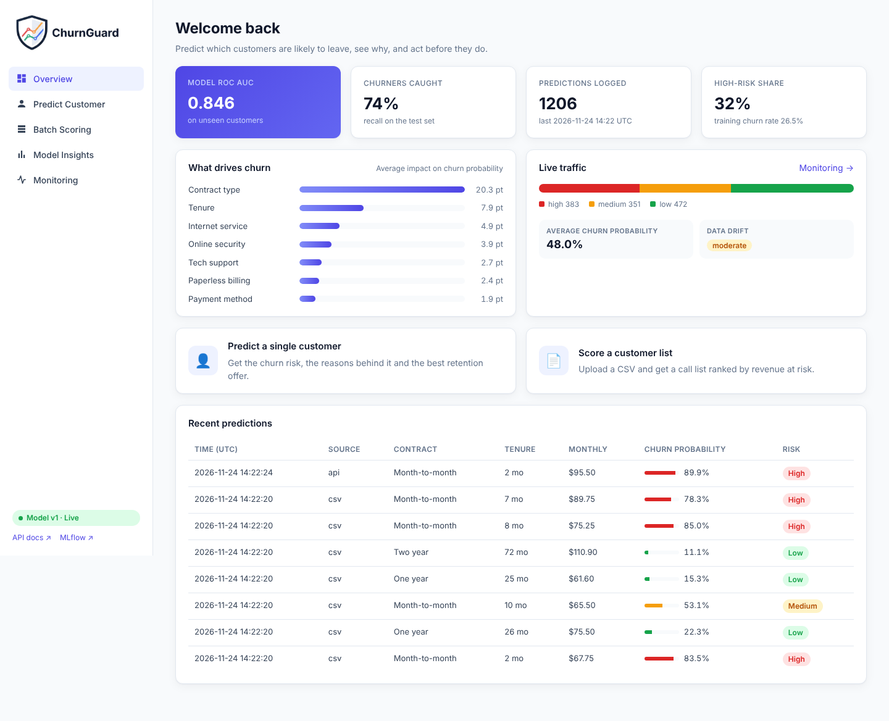
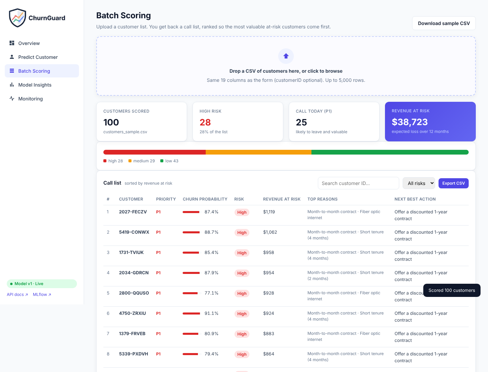
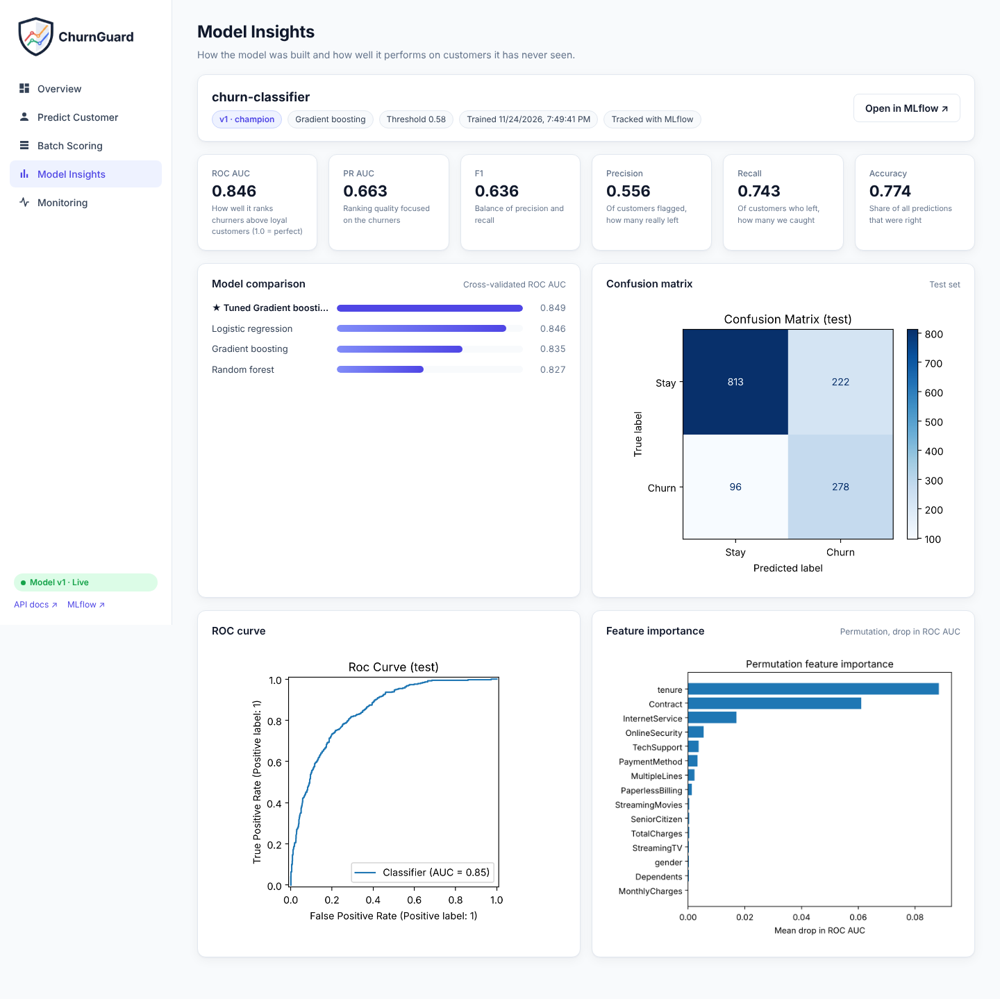
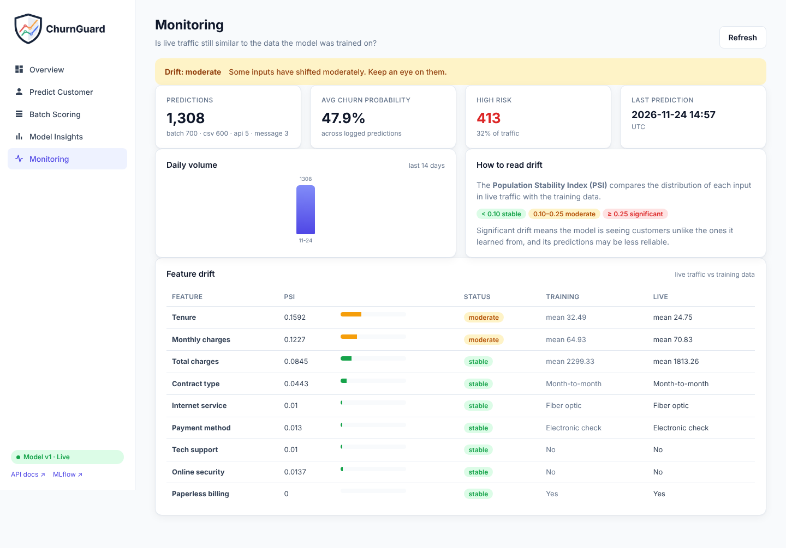
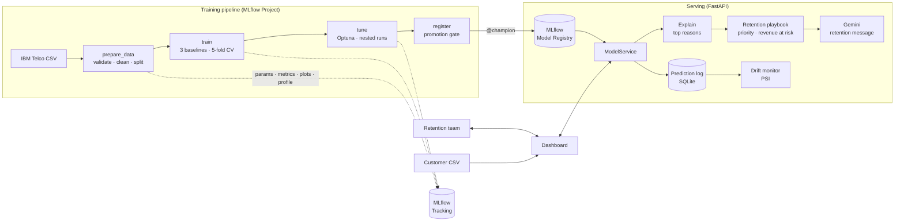

<p align="center"></p>

<p align="center"><b>Predict which customers will leave, explain why, and tell your team what to do about it.</b></p>

<p align="center">
<a href="https://github.com/Am-berneal/churnguard-mlops/actions/workflows/ci.yml"></a>


<a href="LICENSE"></a>
</p>

# ChurnGuard

ChurnGuard is an end-to-end **customer retention system** for a telecom company. A churn score alone doesn't tell a retention team who to call or what to offer, so ChurnGuard answers four questions:

1. **Who** is likely to leave? A calibrated churn probability from a tuned gradient-boosting model (0.846 ROC AUC).
2. **Why** are they at risk? Per-customer reasons, such as "Month-to-month contract" or "Short tenure (2 months)".
3. **What** should we do? Recommended actions from a retention playbook, a priority (P1/P2/P3) and the revenue at risk.
4. **Is the model still right?** Every prediction is logged and checked for data drift against the training data.

The whole ML lifecycle is managed with **MLflow**, from experiment tracking and tuning to the model registry and serving. A built-in **web dashboard** puts all of it in front of business users.

<p align="center"></p>

## Features

**Machine learning and MLOps**
- **Reproducible pipeline:** every step is an MLflow Project entry point with typed parameters
- **Experiment tracking:** parameters, metrics, plots, datasets and the training-data profile are logged for every run
- **Hyperparameter tuning:** Optuna TPE search, with every trial logged as a nested MLflow run
- **Model registry with a promotion gate:** a model only becomes `@champion` if it beats the current one on cross-validated ROC AUC
- **No training/serving skew:** feature engineering, preprocessing and the model ship as one scikit-learn `Pipeline`

**From prediction to decision**
- **Explainable predictions:** model-agnostic counterfactual attribution gives the top reasons behind each score, in plain English
- **Retention playbook:** each reason maps to a concrete action, channel and cost
- **Prioritised call lists:** batch-score a CSV and get customers ranked by *revenue at risk* (probability × 12 months of charges)
- **AI-written outreach:** Gemini drafts a personalized retention message (optional, with an offline template fallback)

**Production**
- **Built-in dashboard:** Overview, Predict, Batch Scoring, Model Insights and Monitoring pages, served by FastAPI with no frontend build step
- **Monitoring:** every prediction is logged to SQLite, and the Population Stability Index (PSI) flags data drift per feature
- **Shipping basics:** Docker Compose stack, 49 tests, Ruff linting, and GitHub Actions CI that trains, scores and starts the API

## Dashboard

| Overview | Batch scoring |
|---|---|
|  |  |
| **Model insights** | **Monitoring** |
|  |  |

## Architecture



### Inspired by real-world AI blueprints

The decision layer follows patterns from Google Cloud's [101 gen AI use cases with technical blueprints](https://cloud.google.com/blog/products/ai-machine-learning/real-world-gen-ai-use-cases-with-technical-blueprints):

| Blueprint | Idea | In ChurnGuard |
|---|---|---|
| #57 Unified customer view | Flag *"high risk of churn due to …"* and prompt proactive outreach | Per-customer reasons and recommended actions |
| #47 AI-enhanced underwriting | A risk score plus a suggested decision, reviewed by a human | Priority, revenue at risk and a playbook action |
| #25 / #85 Productivity agents | An LLM drafts the summary or plan; a person approves it | Gemini drafts the retention message; the agent edits and sends it |
| #101 AI observability | Detect model drift in production and alert the team | Prediction log, PSI drift report and the Monitoring page |
| #41 / #64 Real-time scoring | Score events as they arrive and act on the risk | `/predict`, `/predict/batch` and the ranked call list |

## Installation

**Requirements:** Python 3.10–3.12 and Git. Docker is optional.

(Recommended) Create and activate a virtual environment:

```bash
python -m venv .venv
source .venv/bin/activate        # Windows: .venv\Scripts\activate
 # or
conda create --name churnguard python=3.11
conda activate churnguard
```

### Minimal installation

```bash
git clone https://github.com/Am-berneal/churnguard-mlops.git
cd churnguard-mlops
pip install -r requirements.txt
```

### Development installation

```bash
pip install -r requirements-dev.txt
pytest -q
# 49 passed
```

### Docker installation

```bash
docker compose up --build
```

| Service | URL | What it does |
|---|---|---|
| `mlflow` | http://localhost:5000 | Tracking server and model registry |
| `trainer` | — | Runs the full training pipeline once, then exits |
| `api` | http://localhost:8000 | Dashboard and API; starts after training finishes |

To enable Gemini in Docker: `GEMINI_API_KEY=your-key docker compose up`.

### Environment setup

Every command below assumes these variables are set (the `Makefile` sets them on macOS/Linux):

```bash
export PYTHONPATH=src:.
export MLFLOW_TRACKING_URI=sqlite:///mlflow.db
 # Windows (PowerShell)
$env:PYTHONPATH="src;."
$env:MLFLOW_TRACKING_URI="sqlite:///mlflow.db"
```

## Quickstart

```bash
python -m churn.pipeline --n-trials 30     # 1. train, tune and register the champion (~2–3 min)
uvicorn api.app:app --port 8000            # 2. open http://localhost:8000
python -m churn.simulate --n 300           # 3. (another terminal) send demo traffic
python -m churn.simulate --n 300 --drift   # 4. send shifted traffic and watch the drift alert
```

With `make`: `make pipeline`, `make serve`, then `make demo`.

## Usage

### Run the pipeline as an MLflow Project

```bash
mlflow run . --env-manager local --experiment-name churn-prediction -P n_trials=30
```

```
Saved 5634 train / 1409 test rows to data/processed
[logreg] cv_auc=0.8456 test_auc=0.8416 f1=0.6178
[random_forest] cv_auc=0.8265 test_auc=0.8184 f1=0.5260
[hist_gb] cv_auc=0.8354 test_auc=0.8348 f1=0.6148
Best CV ROC AUC 0.8494 with {'learning_rate': 0.0158, 'max_depth': 2, 'max_iter': 500, ...}
[hist_gb] cv_auc=0.8494 test_auc=0.8456 f1=0.6362
Registered churn-classifier v1 as 'champion'
```

Each step also runs on its own: `-e prepare_data`, `-e train -P model_type=random_forest`, `-e tune -P n_trials=50`, `-e register`, `-e score -P input=customers.csv`.

### Predict and explain one customer

```bash
curl -X POST localhost:8000/predict -H "Content-Type: application/json" -d '{
  "customerID": "DEMO-0001", "gender": "Female", "SeniorCitizen": 0, "Partner": "Yes",
  "Dependents": "No", "tenure": 2, "PhoneService": "Yes", "MultipleLines": "No",
  "InternetService": "Fiber optic", "OnlineSecurity": "No", "OnlineBackup": "No",
  "DeviceProtection": "No", "TechSupport": "No", "StreamingTV": "Yes", "StreamingMovies": "Yes",
  "Contract": "Month-to-month", "PaperlessBilling": "Yes", "PaymentMethod": "Electronic check",
  "MonthlyCharges": 95.5, "TotalCharges": 190.1 }'
```

```json
{
  "customerID": "DEMO-0001",
  "churn_probability": 0.8986,
  "will_churn": true,
  "risk_level": "high",
  "priority": "P1",
  "revenue_at_risk": 1029.75,
  "reasons": [
    {"feature": "Contract", "reason": "Month-to-month contract", "impact": 0.238},
    {"feature": "tenure", "reason": "Short tenure (2 months)", "impact": 0.1763},
    {"feature": "OnlineSecurity", "reason": "No online security add-on", "impact": 0.0628}
  ],
  "actions": [
    {"action": "Offer a discounted 1-year contract", "channel": "Phone call", "cost": "medium", "...": "..."},
    {"action": "Enroll in the new-customer onboarding program", "channel": "Email + call", "cost": "low", "...": "..."}
  ]
}
```

**How the reasons work:** for each factor, ChurnGuard swaps the customer's value for a loyal customer's value (for example, a two-year contract) and measures how much the churn probability drops. `impact: 0.238` means that switching this customer to a longer contract would lower their churn probability by about 24 points. The method only needs `predict_proba`, so it works for any model, and all swaps for a batch are scored in one vectorised call (200 customers in ~0.3 s).

### Write a retention message with Gemini

```bash
export GEMINI_API_KEY=your-key            # free key: https://aistudio.google.com/apikey
curl -X POST localhost:8000/retention-message -H "Content-Type: application/json" \
  -d '{"customer": { ...same fields... }, "tone": "friendly"}'
```

Gemini gets the risk factors and the recommended offer, never names or IDs, and is told not to mention churn or invent discounts. Without a key, or if the call fails, a template message is returned instead, so the feature works offline. Set `GEMINI_MODEL` to use a different model (default `gemini-2.5-flash`).

### Score a customer list

```bash
python -m churn.score examples/customers_sample.csv -o call_list.csv
```

```
Scored 100 customers -> call_list.csv
High risk: 28 | revenue at risk (12 mo): $38,723
customerID  churn_probability priority  revenue_at_risk                 recommended_action
2027-FECZV             0.8736       P1          1118.61 Offer a discounted 1-year contract
5419-CONWX             0.8869       P1          1062.10 Offer a discounted 1-year contract
1731-TVIUK             0.8535       P1           957.65 Offer a discounted 1-year contract
```

Each batch is logged as an MLflow run, with the scored CSV as an artifact. In the dashboard, drop the CSV on the **Batch Scoring** page instead.

| Priority | Meaning |
|---|---|
| **P1** | High risk **and** at least $600 of revenue at risk: call today |
| **P2** | Predicted to churn (above the decision threshold) |
| **P3** | Medium risk: add to the watch list |

### Monitor for drift

```bash
python -m churn.simulate --n 300           # traffic like the training data → "stable"
python -m churn.simulate --n 400 --drift   # newer customers, higher prices → "moderate" / "significant"
curl localhost:8000/monitoring
```

The PSI is computed for the key inputs, comparing live traffic with the training distribution, which is saved with every model as `reference_profile.json`. PSI below 0.10 is **stable**, 0.10–0.25 is **moderate**, and 0.25 or more is **significant** (retrain or investigate). Drift is only reported after 300 predictions: on smaller samples, random noise alone can push PSI above 0.1, which would cause false alarms.

### Load the champion model in Python

```python
import mlflow, pandas as pd

model = mlflow.sklearn.load_model("models:/churn-classifier@champion")
customers = pd.read_parquet("data/processed/test.parquet").head(3)
print(model.predict_proba(customers)[:, 1].round(3))
# [0.078 0.857 0.189]
```

## API Reference

Interactive docs are at http://localhost:8000/docs.

| Method | Endpoint | Description |
|---|---|---|
| `GET` | `/` | Web dashboard |
| `GET` | `/health` | Service status, model version and threshold |
| `GET` | `/model-info` | Model metrics, parameters, threshold and global churn drivers |
| `GET` | `/model/runs` | Recent training runs from MLflow, for model comparison |
| `GET` | `/model/plots/{name}` | ROC, PR, confusion matrix and feature-importance plots |
| `POST` | `/predict` | One customer → probability, risk, priority, revenue at risk, reasons, actions |
| `POST` | `/predict/batch` | A JSON list of customers → results and a summary |
| `POST` | `/predict/csv` | Upload a CSV → results sorted by revenue at risk |
| `POST` | `/retention-message` | Draft a personalized message (Gemini or template) |
| `GET` | `/monitoring` | Prediction volume, risk mix, recent predictions and PSI drift |
| `POST` | `/reload` | Switch to a newly promoted champion without restarting |
| `GET` | `/sample.csv` | Example CSV for batch scoring |

Invalid input returns **422** with the offending field. Prediction endpoints return **503** until a model is registered.

## Configuration

| Variable | Default | Description |
|---|---|---|
| `MLFLOW_TRACKING_URI` | `sqlite:///mlflow.db` | Where runs and the registry live |
| `MLFLOW_EXPERIMENT_NAME` | `churn-prediction` | Experiment used when running scripts directly |
| `MLFLOW_MODEL_NAME` | `churn-classifier` | Registered model name |
| `MODEL_URI` | `models:/churn-classifier@champion` | Model the API serves |
| `GEMINI_API_KEY` | — | Turns on Gemini-written retention messages |
| `GEMINI_MODEL` | `gemini-2.5-flash` | Gemini model to use |
| `LOG_PREDICTIONS` | `1` | Set to `0` to turn off prediction logging and monitoring |
| `PREDICTIONS_DB` | `data/predictions.db` | SQLite file for the prediction log |
| `CORS_ORIGINS` | `http://localhost:3000,http://localhost:5173` | Extra frontends allowed to call the API |

## MLflow Project Entry Points

| Entry point | Parameters | Default | Description |
|---|---|---|---|
| `main` | `n_trials`, `test_size` | `30`, `0.2` | Full pipeline: data → baselines → tuning → registry |
| `prepare_data` | `test_size` | `0.2` | Download, validate, clean and split (stratified) |
| `train` | `model_type`, `params` | `hist_gb`, `{}` | Train and log one model, with 5-fold CV, plots and a data profile |
| `tune` | `model_type`, `n_trials` | `hist_gb`, `30` | Optuna search, then refit and log the best model |
| `register` | `metric`, `min_improvement` | `cv_roc_auc_mean`, `0.0` | Promote the best run to `@champion` if it wins |
| `score` | `input` | `examples/customers_sample.csv` | Batch-score a CSV into a ranked call list |

## Results

**Dataset:** [IBM Telco Customer Churn](https://github.com/IBM/telco-customer-churn-on-icp4d). It has 7,043 customers, 19 features and a 26.5% churn rate, split 80/20 with stratification. Models are ranked by 5-fold cross-validated ROC AUC. The test set is used only for the final report.

| Model | CV ROC AUC | Test ROC AUC | Test F1 | Test Recall |
|---|---|---|---|---|
| Logistic regression | 0.846 | 0.842 | 0.618 | 0.743 |
| Random forest | 0.827 | 0.818 | 0.526 | 0.460 |
| HistGradientBoosting | 0.835 | 0.835 | 0.615 | 0.687 |
| **HistGradientBoosting + Optuna (champion)** | **0.849 ± 0.012** | **0.846** | **0.636** | **0.743** |

|  | Predicted: stay | Predicted: churn |
|---|---|---|
| **Actual: stay** | 813 | 222 |
| **Actual: churn** | 96 | **278** |

The model catches **278 of 374 churners (74%)**. The decision threshold is tuned for F1 (0.58) instead of the default 0.5, accepting some false alarms in exchange for fewer missed churners, because a retention offer costs less than a lost customer.

**What drives churn** (average impact across test customers): contract type (20 pts) ≫ tenure (8) > internet service (5) > online security (4) > tech support (3). The practical takeaway: lock new fiber customers into annual contracts and bundle security and support.

## Testing

| Test file | Tests | Covers |
|---|---|---|
| `tests/test_data.py` | 5 | Schema validation, duplicate IDs, cleaning, stratified split |
| `tests/test_features.py` | 8 | Engineered features, all 3 model types, unseen categories |
| `tests/test_explain_retention.py` | 13 | Data profile, reasons, priority rules, playbook |
| `tests/test_monitoring_genai.py` | 9 | PSI, drift detection, prediction log, Gemini with fallback and privacy |
| `tests/test_api.py` | 14 | Every endpoint, CSV upload, validation, 503 without a model, dashboard |

```bash
pytest -q                  # 49 passed, with no network or trained model needed
ruff check src api tests
```

CI runs lint and tests, then a real training run, batch scoring, an API start-up check with simulated traffic, and a Docker build.

## Project Structure

```
├── MLproject                    # MLflow Project entry points
├── src/churn/
│   ├── config.py                # paths, columns, MLflow names
│   ├── data.py                  # download, validate, clean, split
│   ├── features.py              # FeatureEngineer + model pipelines
│   ├── profile.py               # training-data profile (for explanations and drift)
│   ├── train.py · tune.py       # training and Optuna tuning with MLflow logging
│   ├── evaluate.py              # metrics, threshold tuning, plots
│   ├── register.py              # model registry + champion promotion gate
│   ├── explain.py               # per-customer reasons (counterfactual attribution)
│   ├── retention.py             # risk level, priority, revenue at risk, playbook
│   ├── genai.py                 # Gemini retention messages with template fallback
│   ├── monitoring.py            # prediction log + PSI drift report
│   ├── score.py                 # batch scoring CLI → ranked call list
│   ├── simulate.py              # demo traffic generator (normal / drifted)
│   ├── tracking.py · pipeline.py
├── api/
│   ├── app.py                   # routes only
│   ├── schemas.py               # request/response models
│   ├── service.py               # model loading and prediction logic
│   └── static/                  # dashboard (HTML, CSS, JS, brand assets)
├── examples/customers_sample.csv
├── tests/                       # 49 tests, no network needed
├── docs/                        # screenshots, plots, brand assets (logo, banner, icons)
└── Dockerfile · docker-compose.yml · Makefile · .github/workflows/ci.yml
```

## Roadmap

- [x] Per-customer explanations and a retention playbook
- [x] Gemini-written retention messages
- [x] Prediction logging and drift monitoring
- [x] Web dashboard
- [ ] Automatic retraining when drift turns significant
- [ ] Uplift modelling: predict who will *respond* to an offer, not just who will churn
- [ ] A/B testing of retention offers, with outcomes fed back into training
- [ ] Postgres + S3/MinIO backend for multi-user deployments

## License

This project is released under the [MIT License](LICENSE). The dataset is provided by IBM under its own terms.
